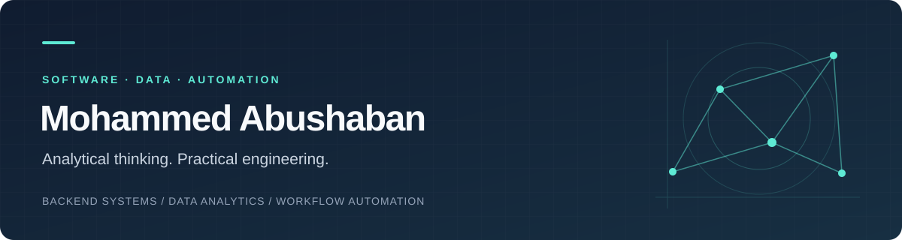

  

  <strong>Backend engineering &nbsp;·&nbsp; Data analytics &nbsp;·&nbsp; Intelligent workflows</strong>

  
  &nbsp;
  

---

## Engineering with an analytical mindset

I build backend services, automate workflows, and turn complex data into clear, useful information. My experience connects **software engineering at NVIDIA**, **health and nutrition analytics at International Medical Corps**, and **warehouse systems and reporting at the World Food Programme**.

Based in **Gaza, Palestine**, I bring a computer science foundation, a strong habit of independent learning, and a practical understanding of the teams who use the systems I build.

> **A foundation in mathematics**  
> I ranked first in mathematics among Gaza high school students. That strength shapes how I approach algorithms, data quality, debugging, and complex problems: break them down, reason carefully, and validate the result.

## What I bring to a project

<table>
<tr>
<td width="50%" valign="top">
<h3>01 / Backend systems</h3>

APIs, business applications, and database integrations designed around real operational needs.

C# · ASP.NET Core · Python · FastAPI · SQL

</td>
<td width="50%" valign="top">
<h3>02 / Data &amp; decisions</h3>

Dashboards, data models, and reporting workflows that make information easier to trust and act on.

Power BI · DAX · Power Query · pandas · Excel

</td>
</tr>
<tr>
<td width="50%" valign="top">
<h3>03 / Workflow automation</h3>

Connected applications and repeatable data pipelines that reduce manual work and keep information moving.

n8n · Azure Functions · Blob Storage · Power Automate

</td>
<td width="50%" valign="top">
<h3>04 / Quality &amp; reliability</h3>

Automated API, regression, and performance tests, supported by hands-on network validation experience.

pytest · Linux · Docker · Kubernetes · Selenium

</td>
</tr>
</table>

## Experience in practice

### World Food Programme
**Logistics Associate** &nbsp;·&nbsp; Jul 2026 – Present

Supporting Logistics Cluster warehouse operations through systems, data, and coordination.

- Build warehouse systems and integrate operational data to support reporting and analysis.
- Develop movement reports and capacity and utilization dashboards.
- Support inventory planning, attendance verification, and staff training coordination.

### International Medical Corps
**Information Management Officer / Data Analyst** &nbsp;·&nbsp; Jan 2025 – Jun 2026  
**Information / Help Desk Assistant** &nbsp;·&nbsp; Sep 2024 – Jan 2025

- Built Power BI dashboards and reporting workflows for health and nutrition programmes.
- Integrated Ona.io data with Python and Azure pipelines; developed validation and deduplication logic.
- Supported data collection, community feedback, and information management.

### NVIDIA
**Software Verification Engineer · Remote** &nbsp;·&nbsp; Sep 2022 – Jan 2024

- Worked on the **NetQ** team using Python and Linux-based environments.
- Developed automated REST API, regression, and performance tests.
- Performed network validation and throughput and latency benchmarking.

<strong>Earlier experience · Backend engineering at TooPOP and FTC</strong>

 

**TooPOP — Backend Engineer · Remote**  
Apr 2021 – Sep 2022

Developed hospital management and client applications using C#, ASP.NET Core, and MySQL, including REST APIs and payment integrations.

**FTC — Backend Engineer · Remote**  
Oct 2019 – Mar 2021

Built backend services with Python and C#, integrated external systems, and worked on database optimization and automation.

## Technical toolkit

| Focus | Technologies |
| :--- | :--- |
| **Languages** | Python, C#, JavaScript, Java, SQL |
| **Backend & APIs** | ASP.NET Core, FastAPI, Flask, Express.js, Entity Framework |
| **Databases** | MySQL, PostgreSQL, SQL Server, MongoDB |
| **Analytics** | Power BI, DAX, Power Query, pandas, Excel |
| **Automation & cloud** | n8n, Power Automate, Azure Functions, Azure Blob Storage |
| **Testing & infrastructure** | pytest, Selenium, unittest, TestNG, Linux, Docker, Kubernetes |
| **Tools & integrations** | Git, GitHub, Gerrit, Postman, Swagger, Ona.io, XLSForm |

## Learning & interests

**B.Sc. Computer Science** — Islamic University of Gaza · 2018–2022  
**Software Engineering Bootcamp** — Hack Reactor · 2020 · Approximately 1,400 hours

I'm currently exploring **AI-assisted development and multi-agent coding workflows**, alongside **Odoo-based accounting and point-of-sale applications**. I'm also interested in the connections between **mathematics, finance, economics, and data**.

Away from the keyboard: martial arts and swimming.

---

  <strong>Have a system to build, a workflow to automate, or data to make sense of?</strong> 
  Open to remote and freelance work in backend development, analytics, automation, and software testing.  
  <a href="https://www.linkedin.com/in/m-aboushaaban/"><strong>Let's connect on LinkedIn →</strong></a>

  Arabic (native) · English 
  Some professional work is confidential; public repositories reflect only part of my experience.

